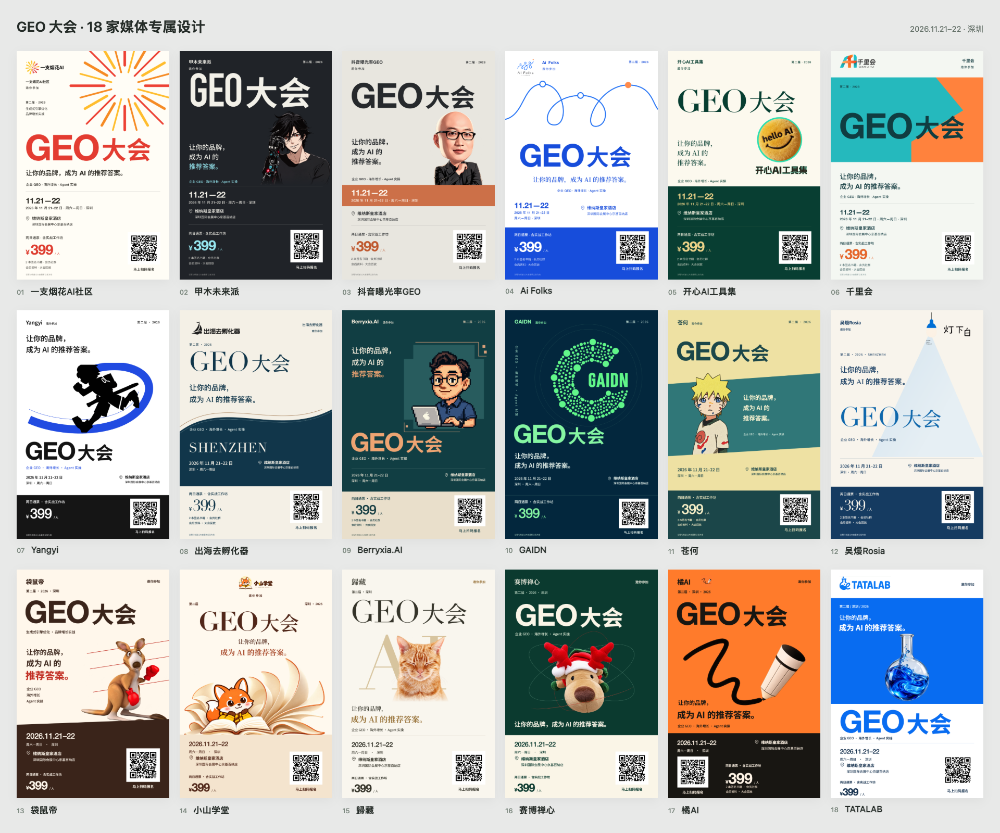
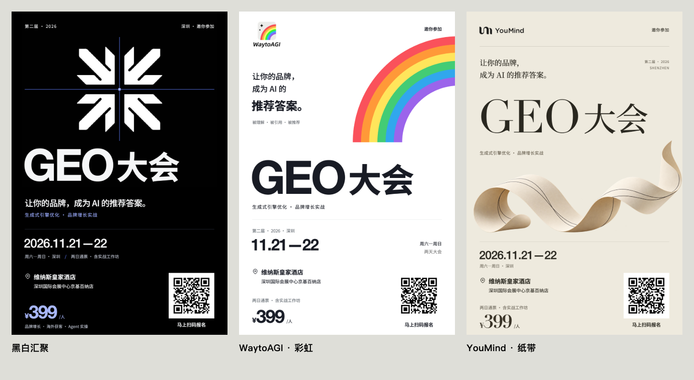

# 乔木商业海报 · Qiaomu Poster

**给一个网址、一份活动信息或一个 Logo，做出信息准确、品牌鲜明、可以直接扫码报名的商业海报。**

从读取活动资料、构思主视觉，到精确排字、生成二维码、逐张看图、导出高清图与可编辑源文件。支持单张创作，也支持每家媒体独立构图的联名系列。



[查看全部 18 张高清案例](examples/README.md) · [设计方法](references/design-method.md) · [生图工作流](references/image-workflow.md) · [验收报告](examples/geo-2026/audit-report.json)

## 新增三张品牌案例

黑白汇聚、WaytoAGI 彩虹与 YouMind 纸带，三种独立构图。



[黑白汇聚高清图](examples/geo-three-brands/01.png) · [WaytoAGI 高清图](examples/geo-three-brands/02.png) · [YouMind 高清图](examples/geo-three-brands/03.png) · [下载三张高清图与源文件](examples/geo-three-brands/three-brand-posters-and-source.zip)

原18张案例保留，本次新增3张，共21张。新增案例的全尺寸/手机缩图二维码、必需文案、标题分组和文字边界均通过检查。[新增案例说明](examples/geo-three-brands/README.md)

## 一行安装

```bash
npx skills add joeseesun/qiaomu-poster --skill qiaomu-poster
```

安装到支持 Agent Skills 的宿主后直接描述任务。没有图像生成能力的宿主仍可使用用户素材排版，但不能宣称完成了新的 AI 主视觉创作。

## 你可以直接这样说

> 用这个活动网址做一张宣传报名海报。面向创业者，科技感强一点；酒店用我补充的地址，二维码用这个报名链接。

> 根据表格里所有媒体名称和 Logo，每家做一张专属邀请海报。头像自然融入画面，各张有不同构图，保留时间、地点、票价和扫码报名。

> 修改这张海报：把英文与中文标题作为一组重新排版，Logo 不要像贴纸，检查手机上二维码能否识别。交付高清图和源文件。

无需先学专业术语。网址不能读取或关键事实缺失时，agent 只补问会阻塞制作的信息。

## 它具体做什么

| 环节 | 做法 | 交付或证据 |
| --- | --- | --- |
| 读资料 | 读取原始网址；核对用户覆盖项与表格总数 | brief、事实与素材清单 |
| 构思 | 从品牌形状、内容和受众提出具体隐喻 | 主张、构图、文字角色 |
| 生图 | 宿主图像工具生成或编辑主视觉，保留品牌身份 | 原始 Logo 与衍生图分存 |
| 排版 | HTML/CSS、本地字体、真实二维码；中英标题光学分组 | 可编辑 HTML 与素材 |
| 校验 | 实际浏览器渲染、手机缩图扫码、内容与边界检查 | PNG、画廊、审计 JSON |
| 复核 | 逐张检查字重、遮挡、边缘、留白和品牌融合 | 人可打开的最终成品 |

**品牌专属来自构图和叙事。** 不把一套模板换色、换头像冒充独立设计；也不把“高级、炫酷”当作具体创意。

## 已验证的案例

GEO 大会系列包含 **18 张 2160 × 3240 PNG**、对应 HTML、本地 Logo/衍生图、字体与二维码。现有真实案例经过标题间距、头像背景、角色截断、图文遮挡等多轮修改。

本技能运行时重新渲染了全部 18 张：必需文本、图片加载、文字越界、标题分组及全尺寸/540px 宽缩图二维码检查均通过。另有 10 个自动回归测试覆盖正常输出和错误路径。技术结果不能证明用户最终审美认可、报名转化提升或印刷认证。[证据与边界](reports/output-evidence.json)

示例中的会议事实与二维码仅属于原活动，新任务必须重新读取、核对和生成。案例 Logo、头像及角色权利归各自权利人，不能因代码开源而获得通用商用授权。[案例许可说明](examples/NOTICE.md)

## 运行前准备

- Python 3.10+；首次安装需网络及磁盘空间。
- Agent 宿主提供网址读取、本地文件、实际看图能力；需要新主视觉时还应提供图像生成/编辑工具。
- 运行时依赖锁定安装到 skill 自身 `.deps/`，不污染系统 Python。无需保存任何模型 API 密钥。

在安装后的 skill 目录运行；通常由 agent 自动完成：

```bash
python3 scripts/setup.py --check
python3 scripts/setup.py
python3 scripts/run.py qr https://example.org/register --output /project/assets/qr.png
python3 scripts/run.py render /project/posters.json
python3 scripts/run.py audit /project/posters.json
python3 scripts/run.py gallery /project/posters.json
```

[清单格式与完整字段](references/manifest.md)。所有项目输出在用户项目目录中，勿覆盖技能案例。渲染器只接收已检查的本地 HTML，阻断 HTTP(S) 资源请求；不要用它执行不可信网页。

开发验证：

```bash
python3 -m unittest discover -s tests -p 'test_*.py'
# 可选：已安装 qiaomu-meta-skill 的维护者运行其 validate_skill.py <本技能目录>
```

## Troubleshooting

**只有网址可以吗？** 可以。先读取信息并提取核心事实；若来源没有日期、票价或报名入口，不能编造。Logo 可由用户提供或从已授权来源读取。

**没有生图工具怎么办？** 使用已有照片、Logo 和原创文字构图，说明素材限制。不会静默切换到收费 API，也不会假称调用了“最大算力”或不存在的质量参数。

**为什么图片明明存在，却渲染失败？** 检查格式、文件损坏与尺寸。本案例 04 含 10000 × 10000 JPG，自带 Chromium 145 的 `decode()` 失败，本机 Chrome 成功。不要吞掉解码错误；可选择已安装、已验证的浏览器重新渲染：

```bash
POSTER_BROWSER_EXECUTABLE='/Applications/Google Chrome.app/Contents/MacOS/Google Chrome' \
  python3 scripts/run.py render /project/posters.json
```

其他系统可指定其浏览器绝对路径。字体替代、系统和浏览器版本可能改变细节，因此必须重新看图。Linux 若缺浏览器系统库，按 Playwright 错误提示安装所需系统依赖。

**自动通过就代表好看吗？** 不是。检查器验证事实文字、可测几何和二维码；它不知道品牌定位是否恰当，也无法预测转化率。真实画面审阅不可省略。

**可以直接印刷吗？** 默认交付适合数字传播的 PNG 与 HTML。印刷项目需另行确认成品尺寸、出血、分辨率、色彩管理与印厂要求。

<!-- qiaomu-profile:start -->
## 关于向阳乔木

向阳乔木（乔向阳 / Joe）是一位实践型 AI 产品与内容创作者，长期把前沿 AI 变化转译成可复用的工作流、产品判断、AI 编程实践、AI 搜索实践和 GEO/AI 营销方法。

- 个人网站: https://qiaomu.ai
- 博客: https://blog.qiaomu.ai
- X: https://x.com/vista8
- GitHub: https://github.com/joeseesun/
- 微信公众号: 向阳乔木推荐看

### 支持与关注

| 打赏支持 | 微信公众号 |
|---|---|
|  |  |
| 感谢支持乔木持续分享 AI 实践 | 扫码关注「向阳乔木推荐看」 |

<!-- qiaomu-profile:end -->

## English

Qiaomu Poster creates commercial event and registration posters from URLs, briefs and brand assets. It combines a brand-led visual concept, host-native image generation/editing, editable HTML typography and deterministic QR generation. It includes 21 real examples and a browser-rendered regression suite. Automated checks establish technical correctness, not aesthetic quality or conversion lift.

## 方法来源与许可

使用乔木 Meta Skill 研究和构建，使用乔木 Skill Publisher 发布。借鉴 Adobe、W3C、Monotype 的公开设计资料，以及 k2f-event-poster、Anthropic frontend-design、OpenAI imagegen、K-Dense latex-posters 的相关方法；未复制其代码或提示词。[来源与取舍](reports/prior-art-research.md)

原创代码及文档采用 [MIT](LICENSE)。第三方案例素材与字体按 [各自许可](examples/NOTICE.md)。作者：**向阳乔木** · [X @vista8](https://x.com/vista8) · [GitHub @joeseesun](https://github.com/joeseesun)。
